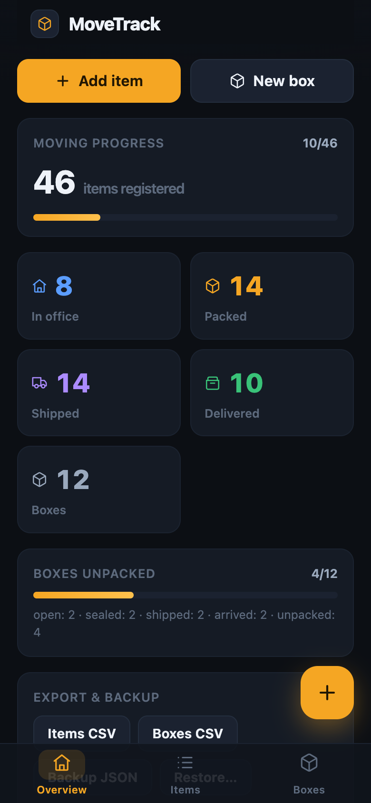
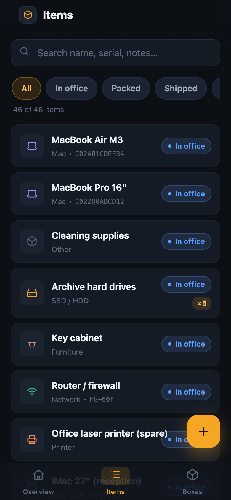
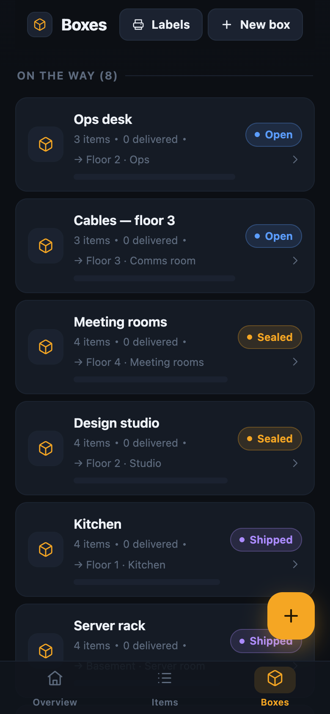
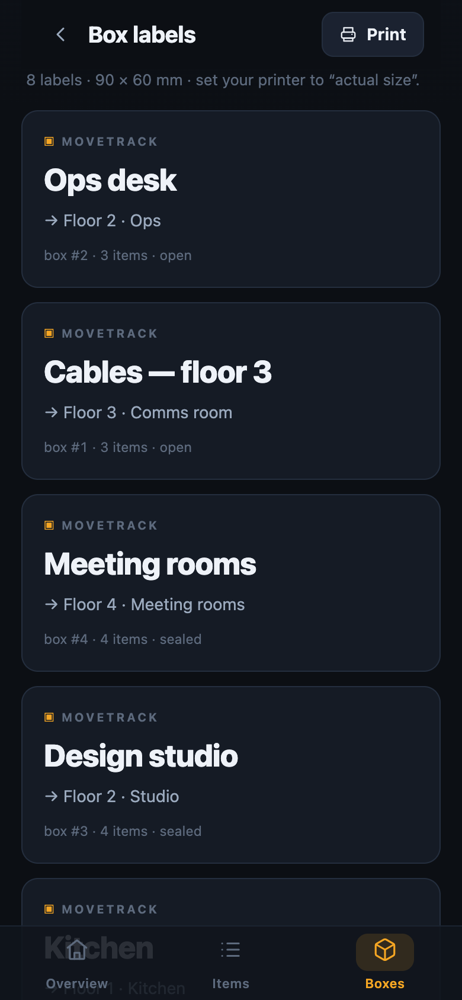

# MoveTrack

**A tiny, local-first inventory for the chaos of moving offices.** Register every asset
from your phone, pack it into a box, then follow the box through sealing, shipping,
arrival and unpacking — one tap per step, no accounts, no cloud, no monthly fee.

[](https://github.com/mrsase/movetrack/actions/workflows/ci.yml)
[](#license)
[](https://nodejs.org)

<p align="center">
  
  
  
  
</p>

## Why this exists

Moving an office is an inventory problem disguised as logistics. You need to answer three
questions at any moment: *what do we own*, *what is in which box*, and *has that box arrived
and been unpacked*. Spreadsheets fall apart the moment two people are packing at once, and
SaaS inventory tools want an account, a subscription and a network connection.

MoveTrack is one Node process on one machine. Phones connect over the office Wi-Fi. The
database is a single SQLite file you can copy.

- **Local-first** — no accounts, no cloud, no telemetry. `DB_PATH` is a file you own.
- **Phone-first** — built at 390 px, thumb-reachable actions, LAN discovery printed at startup.
- **Honest state machine** — a box cannot be shipped twice, and unpacking is what delivers its
  contents. The server enforces it; the UI never has to guess.
- **Leaves with your data** — CSV for spreadsheets, JSON backup that restores in one request.

## Quick start

Requires **Node ≥ 22.13** (built-in `node:sqlite`; no native build steps).

```bash
git clone https://github.com/mrsase/movetrack.git
cd movetrack
npm run setup
npm run demo      # builds, seeds a 46-item move, serves http://localhost:4000
```

Open <http://localhost:4000>. The startup banner prints the LAN address; open that on any
phone connected to the same Wi-Fi.

Want an empty move instead?

```bash
npm run build
npm start         # http://localhost:4000, database at server/data/move.db
```

On macOS you can also double-click **`run.command`** — it installs, builds once, prints the
phone URL and stops everything with a single `Ctrl+C`.

### Development

```bash
npm run dev        # API :4000 + Vite :5173, proxy wired
npm run verify     # typecheck + lint + 72 tests + production build
npm run smoke      # 25 end-to-end checks on throwaway databases
npm test           # unit, route and component tests only
```

`npm run verify` is the gate CI runs. `npm run smoke` starts two real servers, drives the
whole lifecycle, exports, restores into a second database and compares the stats.

## The workflow

| Step | What happens |
| --- | --- |
| **Register** | Name + category, optional serial, quantity, destination room, notes. Status: *In office*. |
| **Pack** | Pick an open box — one tap each, or select all visible. Item becomes *Packed*. |
| **Seal** | Tape the box. A sealed box refuses new items until you reopen it. |
| **Ship** | The box moves. Every item inside becomes *Shipped*. |
| **Arrive** | The box reached the new office. |
| **Unpack** | Everything inside becomes *Delivered*, and the box is done. |

Carried something by hand? **Mark delivered** on the item directly. Made a mistake?
**Unpack back to the office** restores it.

## Box labels

**Boxes → Labels** renders one 90 × 60 mm label per active box with its destination, item
count and box number. Print, tape, done. Unpacked boxes are excluded from the batch; open a
single box and use the printer icon in its header to reprint just that label.

## Export and backup

| Button | Endpoint | What you get |
| --- | --- | --- |
| Items CSV | `GET /api/export/items.csv` | Every item, box label joined, UTF-8 BOM, RFC 4180 quoting |
| Boxes CSV | `GET /api/export/boxes.csv` | Every box with its item count |
| Backup JSON | `GET /api/export/backup.json` | Versioned snapshot of both tables |
| Restore… | `POST /api/import/backup` | Replace-all restore, validated before any write |

CSV cells that begin with `=`, `+`, `-` or `@` are prefixed with `'` so a spreadsheet cannot
execute them. Restore requires `"confirmation": "replace-all"` and runs in a single
transaction: a rejected import leaves the existing data untouched (covered by tests).

## API

```
GET    /api/health
GET    /api/stats                              dashboard numbers
GET    /api/items?q=&status=&category=&box=&limit=&offset=
POST   /api/items                              { name*, category, serial, quantity, notes, destination }
GET    /api/items/:id
PATCH  /api/items/:id
DELETE /api/items/:id
POST   /api/items/:id/box   { box_id }         pack into an open box
DELETE /api/items/:id/box                      take it back out

GET    /api/boxes                              with item counts
POST   /api/boxes                              { label?, destination? } — auto-named “Box N”
GET    /api/boxes/:id                          box + contents
PATCH  /api/boxes/:id                          { label, destination }
POST   /api/boxes/:id/action                   { action: seal|reopen|ship|arrive|unpack }
DELETE /api/boxes/:id                          contents return to “in office”

GET    /api/export/items.csv
GET    /api/export/boxes.csv
GET    /api/export/backup.json
POST   /api/import/backup                      { ...backup, confirmation: "replace-all" }
```

Environment: `PORT` (4000), `DB_PATH` (`server/data/move.db` by default).

## Architecture

```
office-move/
├── server/            Express 5 + node:sqlite
│   ├── src/
│   │   ├── app.ts     routes, static hosting, no-store API, error handler
│   │   ├── db.ts      WAL, foreign keys, idempotent schema
│   │   ├── schema.ts  boxes + items DDL
│   │   ├── csv.ts     RFC 4180 writer + formula guard
│   │   ├── validate.ts hand-rolled input validation
│   │   └── routes/    items · boxes · stats · export/import
│   ├── scripts/       demo seed
│   └── test/          supertest, one in-memory DB per test
├── client/            React 19 + Vite, no UI framework, no state library
│   ├── src/views/     dashboard, items, item form/detail, boxes, box detail, labels
│   ├── src/components/nav, sheets, rows, chips, toasts, search
│   └── theme.css      the whole design system (dark, amber, phone-first)
├── scripts/smoke.mjs  end-to-end proof on real ports
└── docs/              design, test plan, verification, validation, evaluation
```

**Design choices worth knowing**

- `node:sqlite` (`DatabaseSync`) instead of `better-sqlite3`: zero native builds, one runtime.
- No UI framework: plain React + `fetch` + a 12-line pub/sub bus for cross-view refresh.
- Server-side filtering and one-way box transitions; errors are JSON bodies the UI shows as toasts.
- API responses are `Cache-Control: no-store`. This is live data; a cached dashboard lied once
  during validation and will not again.

## The process behind v1.0

This release was finished with a seven-phase loop, documented in
[`docs/CYCLE.md`](docs/CYCLE.md): design → code → test → verify → validate → evaluate → ship.
Each phase has an artifact and a gate:

| Phase | Artifact | Gate |
| --- | --- | --- |
| Design | [docs/design.md](docs/design.md) | acceptance criteria with owners |
| Test | [docs/test-plan.md](docs/test-plan.md) | `npm test` (72 tests) |
| Verify | [docs/verification.md](docs/verification.md) | `npm run verify` |
| Validate | [docs/validation.md](docs/validation.md) | `npm run smoke` + driven browser |
| Evaluate | [docs/evaluation.md](docs/evaluation.md) | measured go/no-go |
| Ship | this README + CI + tag | public repo, green CI |

Validation found seven real defects — dead retry buttons, invisible progress bars, stale
dashboard data, a mis-seeded demo database, missing categories, a wrong form default and an
orphaned desktop tile. All are fixed here with tests or documented checks.

## Roadmap

- **v1.1** — QR labels so a box can be opened by scanning; photo attachments per item.
- **v1.2** — optional shared token for the LAN, and an import mode that merges instead of replacing.
- **Later** — multi-move workspaces, per-floor views, printable inventory manifest.

Not planned: accounts, cloud sync, billing. The point is that it runs on your machine.

## License

MIT © 2026 Ali Goli ([@mrsase](https://github.com/mrsase)). Your move is the interface.
